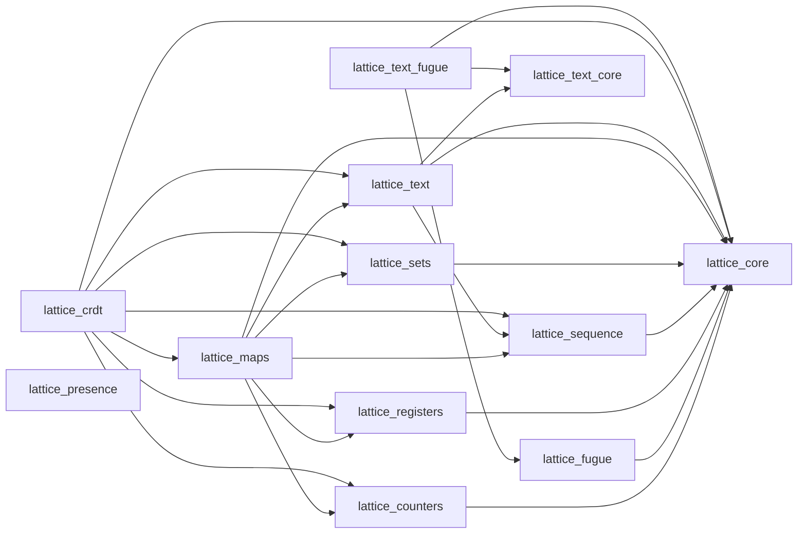

import PackageCatalog from "../../components/PackageCatalog.astro";

## Which approach to choose

- If you are prototyping or need several CRDT types, run `gleam add lattice_crdt`.
  The umbrella includes the causal core, counters, registers, sets, maps,
  sequence, and text.
- If you only need counters, run `gleam add lattice_counters`. You can install
  other individual packages the same way.
- To track who is online, run `gleam add lattice_presence`, even if you
  already use the umbrella.

See [Installation](/installation/) to install a package and pin its version.

## Packages

<PackageCatalog />

## Dependencies



Three packages need no other lattice packages. `lattice_text_core` depends
only on `gleam_stdlib`. Both `lattice_core` and `lattice_presence` depend on
`gleam_stdlib` and `gleam_json`.

## Import paths

After you install the umbrella, use the individual package names in your
imports. For example:

```gleam
import lattice_core/replica_id
import lattice_counters/g_counter
import lattice_sets/or_set
import lattice_maps/or_map
import lattice_sequence/sequence
import lattice_text/text
```

### Optional presence package

Install `lattice_presence` before using the import in the
[Presence guide](/guides/presence/):

```gleam
import lattice_presence/presence_state as presence
```

### Evaluating the Fugue packages

Hex does not yet list `lattice_fugue` or `lattice_text_fugue`. With Gleam
1.18 or later, add the package you need as a Git dependency in `gleam.toml`.
The `path` starts at the root of the Git repository:

```toml
[dependencies]
lattice_fugue = { git = "https://github.com/tylerbutler/lattice.git", ref = "main", path = "packages/lattice_fugue" }
lattice_text_fugue = { git = "https://github.com/tylerbutler/lattice.git", ref = "main", path = "packages/lattice_text_fugue" }
```

To pin the revision you tested, replace `main` with its commit hash. Use the
import for the package you added:

```gleam
import lattice_fugue/sequence
import lattice_text_fugue/text
```
