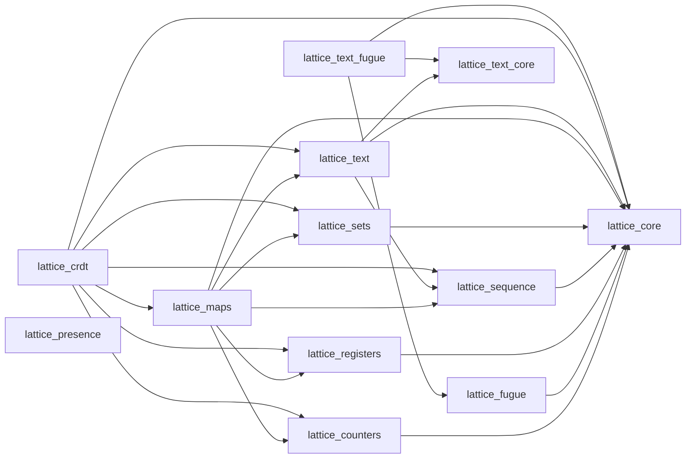

import PackageCatalog from "../../components/PackageCatalog.astro";

## Which approach to choose

- For a prototype or several types of CRDT, use `gleam add lattice_crdt`.
  The umbrella includes the causal core, counters, registers, sets, maps,
  sequence, and text.
- For one type of CRDT, install its package. For example, use
  `gleam add lattice_counters` if you only need counters.
- To track who is online, use `gleam add lattice_presence`. You need this
  package even if you have the umbrella.

See [Installation](/installation/) to install a package and pin its version.

## Packages

<PackageCatalog />

## Dependencies



The only packages with no lattice package dependencies are `lattice_core`,
`lattice_text_core`, and `lattice_presence`. `lattice_text_core` depends only on
`gleam_stdlib`; `lattice_core` and `lattice_presence` also depend on
`gleam_json`.

## Import paths

After `gleam add lattice_crdt`, import the modules you need from their own
packages. For example:

```gleam
import lattice_core/replica_id
import lattice_counters/g_counter
import lattice_sets/or_set
import lattice_maps/or_map
import lattice_sequence/sequence
import lattice_text/text
```

### Optional presence package

After `gleam add lattice_presence`, use this import to follow the
[Presence guide](/guides/presence/):

```gleam
import lattice_presence/presence_state as presence
```

### Evaluating the Fugue packages

`lattice_fugue` and `lattice_text_fugue` are not published to Hex yet. To
evaluate either package, clone the lattice repository and declare the package as
a local path dependency in your project's `gleam.toml`:

```toml
[dependencies]
lattice_fugue = { path = "../lattice/packages/lattice_fugue" }
lattice_text_fugue = { path = "../lattice/packages/lattice_text_fugue" }
```

Keep the entries you need and adjust the paths to match your clone. Use the
import for the package you added:

```gleam
import lattice_fugue/sequence
import lattice_text_fugue/text
```
